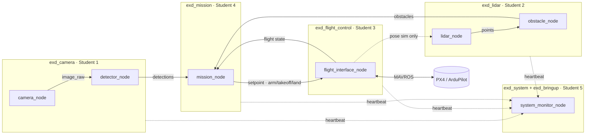

# Escape-x-Drone

ROS 2 base workspace for the Escape-x-Drone student project. Five students, five
subsystems, one shared contract. **Everything runs in simulation out of the box**,
so each student can develop their part on a laptop without the drone or the
other students' code being finished.



## Packages and owners

| Package | Owner (role) | What it does |
|---|---|---|
| `exd_interfaces` | **whole team** | Shared `.msg` / `.srv` files — the contract |
| `exd_common` | **whole team** | Topic names, frame names, `ExdNode` base class |
| `exd_camera` | Student 1 — Camera & Perception | Camera driver, object detection |
| `exd_lidar` | Student 2 — LiDAR & Obstacles | LiDAR driver, obstacle extraction |
| `exd_flight_control` | Student 3 — Flight Control | The only bridge to the autopilot (sim / MAVROS) |
| `exd_mission` | Student 4 — Mission & Navigation | Mission state machine, decisions |
| `exd_system`, `exd_bringup` | Student 5 — Jetson & Integration | Health monitor, launch files, Jetson setup, CI |

See [docs/ROLES.md](docs/ROLES.md) for a suggested scope and milestones per role,
and [docs/ARCHITECTURE.md](docs/ARCHITECTURE.md) for every topic and service.

## Quick start

Requires **ROS 2 Humble** on Ubuntu 22.04 (same as JetPack 6 on the Jetson).
No Ubuntu? Use Docker — see below.

```bash
git clone https://github.com/M-Okour/Escape-x-Drone.git
cd Escape-x-Drone
rosdep install --from-paths src --ignore-src -y
colcon build --symlink-install
source install/setup.bash

# run the whole drone in simulation, mission starts by itself
ros2 launch exd_bringup exd.launch.py auto_start:=true
```

In another terminal (`source install/setup.bash` first):

```bash
ros2 topic echo /exd/mission/status          # watch the mission
ros2 topic echo /exd/system/health           # health of every node + computer
ros2 service call /exd/mission/start std_srvs/srv/Trigger   # if auto_start was false
ros2 service call /exd/mission/abort std_srvs/srv/Trigger
rviz2                                         # fixed frame "map": TF, /exd/lidar/points, camera image
```

### Run only your subsystem

Every subsystem can be switched off from the launch file:

```bash
ros2 launch exd_bringup exd.launch.py camera:=true lidar:=false flight:=false mission:=false
ros2 run exd_camera camera_node --ros-args -p sim_mode:=false   # one node, real hardware
```

### Docker

```bash
docker build -t exd -f docker/Dockerfile .
docker run -it --rm -v $(pwd):/ws exd
colcon build --symlink-install && source install/setup.bash
```

## Sim mode vs. hardware

Every node inherits `sim_mode` from `ExdNode` (`exd_common/base_node.py`).
`sim:=true` (default) makes each node fake its own data:

- camera → moving test pattern with a white "target" square
- lidar → scan of a 10 m × 6 m room, following the simulated drone pose
- flight → point-mass drone that obeys arm / takeoff / setpoint / land

This built-in sim is only a lightweight stand-in for quick laptop work and CI.
The project's full simulator is **Gazebo** (with PX4/ArduPilot SITL), used to test
the real flight stack and the whole mission before flying.

### On the drone (Jetson)

`sim:=false` runs the real hardware. On the Jetson (JetPack 7.2, ROS 2 Jazzy)
this also starts the RealSense D455 and RPLIDAR A2M12 drivers; the Pixhawk 6X
is reached over Ethernet through MAVROS:

```bash
ros2 launch exd_bringup exd.launch.py sim:=false flight:=false mission:=false   # sensors only
ros2 launch mavros apm.launch fcu_url:=udp://0.0.0.0:14550@                      # flight controller
```

Setup, wiring, how to test and view each device, and known issues:
[docs/JETSON.md](docs/JETSON.md).

Replace the fake part with real hardware **inside your own package**. As long as
you publish the same topics with the same message types, nobody else has to change
anything.

## Testing

```bash
colcon test && colcon test-result --verbose   # unit tests in src/*/test
./scripts/smoke_test.sh                       # full stack in sim must reach DONE
```

GitHub Actions runs build + unit tests + smoke test on every push and PR.

## Working together

Read [CONTRIBUTING.md](CONTRIBUTING.md) before your first commit. Short version:
branch from `main` as `<subsystem>/<what>`, open a PR, CI must be green, and any
change to `exd_interfaces` or `exd_common` needs the whole team's review.
